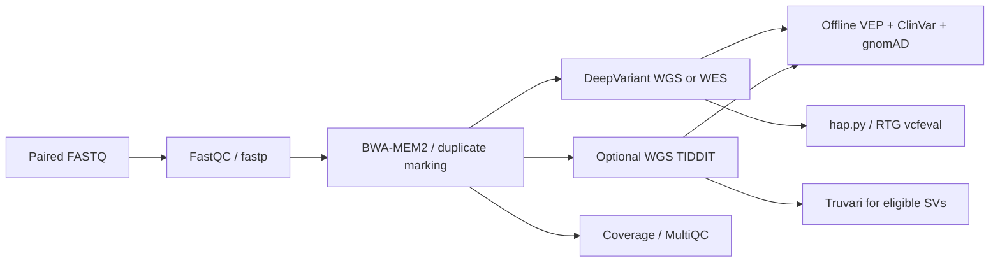

# Short-read variant pipeline

Reproducible **human germline Illumina WGS/WES** preprocessing, variant calling,
offline annotation, and truth-set benchmarking. This repository runs a pinned
nf-core/sarek workflow and provides independent annotation/benchmark entry points.
It is the short-read companion of
[long-read-variant-pipeline](https://github.com/Homabazireh/long-read-variant-pipeline).



## Quick start

Prerequisites: Linux, Python 3.10+, Java 21, samtools, bcftools, and Apptainer
(or a working Docker daemon). Install the checksum-pinned Nextflow executable:

```bash
bash scripts/install_nextflow.sh
export PATH="$PWD/.tools:$PATH"
bin/doctor --profile apptainer
```

Prepare a sample CSV and a reference JSON using the documented contracts:

```csv
sample,assay,lane,fastq_1,fastq_2,target_bed
HG002,WGS,L001,/data/HG002_R1.fastq.gz,/data/HG002_R2.fastq.gz,
```

```json
{
  "schema_version": 1,
  "genome_build": "GRCh38",
  "reference_fasta": "/references/GRCh38.fa",
  "reference_sha256": "REPLACE_WITH_THE_REFERENCE_SHA256"
}
```

The reference must be uncompressed and indexed (`samtools faidx`). Replace every
example path and checksum with an actual local resource. WES requires a capture
BED matching the supplied reference. Resource preparation is described in
[resources](docs/resources.md).

```bash
bin/run --input samples.csv --resources resources.json \
  --outdir /analysis/short-read-01 --profile apptainer \
  --cpus 16 --memory-gb 96 --dry-run

bin/run --input samples.csv --resources resources.json \
  --outdir /analysis/short-read-01 --profile apptainer \
  --cpus 16 --memory-gb 96
```

Use `--sv` for WGS TIDDIT, `--caller haplotypecaller` for the GATK comparison
profile (requires known sites), `--executor slurm --queue PARTITION` for Slurm,
and `--resume` to continue a matching interrupted run. Initial full-GRCh38
BWA-MEM2 indexing needs substantial memory; request at least 96 GB even for a
small evaluation interval. Local resource requests are scheduling limits, not
operating-system memory enforcement.

## Annotation and benchmarking

Calling writes `calls.csv` with `sample,label,vcf,variant_type` columns. Add the
VEP cache and annotation resources to your resource JSON before annotation:

```bash
bin/annotate --input /analysis/short-read-01/calls.csv \
  --resources resources.json --outdir /analysis/short-read-01-annotation \
  --profile apptainer --cpus 8 --memory-gb 32

bin/benchmark --input benchmark.csv --resources resources.json \
  --outdir /analysis/short-read-01-benchmark --profile apptainer \
  --cpus 8 --memory-gb 32
```

The benchmark CSV adds `truth_vcf,truth_bed`; see the example and
[benchmarking guide](docs/benchmarking.md). For scoped analyses, supply
`--regions evaluation.bed`. WES assessment must use the unpadded reporting
intervals. External MegSAP/DRAGEN VCFs use the same interfaces.

## Outputs and support boundary

- Original indexed calls, caller gVCFs where produced, alignment files, coverage
  statistics and MultiQC; optional WGS structural-variant calls.
- Annotated VCF/TSV with all transcript consequences and resource provenance.
- Native benchmark results, summary JSON/CSV/HTML, execution traces and manifests.
- Checked reference identity, sample/assay consistency, explicit interval scope,
  and restart checks. Empty valid callsets remain valid inputs.

The initial calling scope is **GRCh38 autosomes**. Sex-chromosome ploidy,
mitochondrial analysis, repeat expansions, dedicated CNV analysis, somatic
analysis, and cohort joint genotyping are not implemented. This is a research
workflow; analytical validation for a particular assay is a separate activity.

## Documentation and verification

- [Short-read workflow and sample contract](docs/short-read-workflow.md)
- [Annotation](docs/annotation.md) and [benchmarking](docs/benchmarking.md)
- [Reference and resource preparation](docs/resources.md)
- [Measured validation status](docs/validation.md)
- [Third-party projects, licenses and data](THIRD_PARTY.md)

Run `python3 -m unittest discover -s tests -v` for automated validation and
report-parser tests. See the validation report for actual tool executions;
unit tests are not measurements of variant-calling accuracy.

Pipeline foundation: [nf-core/sarek 3.10.0](https://nf-co.re/sarek/3.10.0/).
Design inspiration: [MegSAP](https://github.com/imgag/megSAP).
DRAGEN is not bundled; its exported calls can be benchmarked without copying or
reimplementing licensed DRAGEN software.
